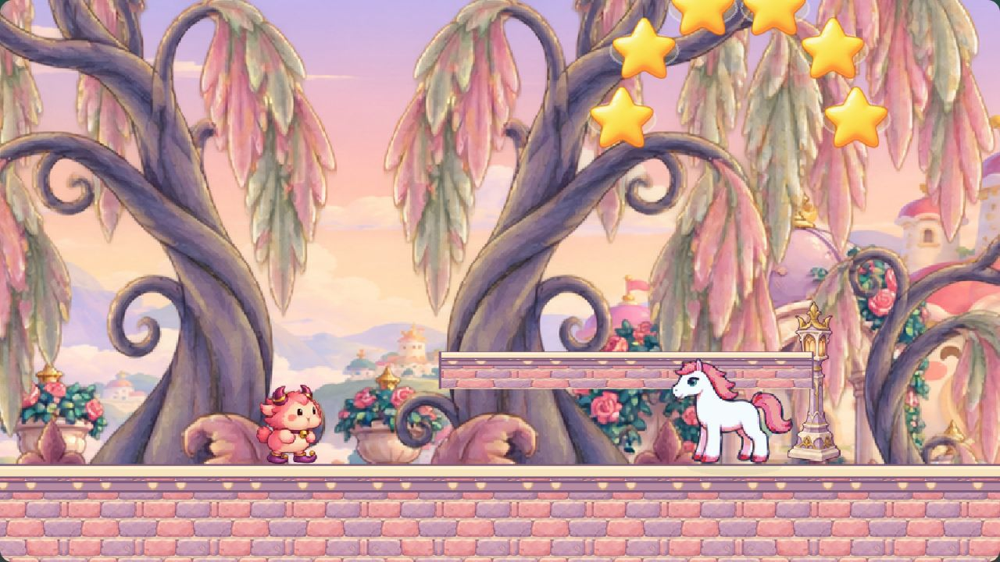
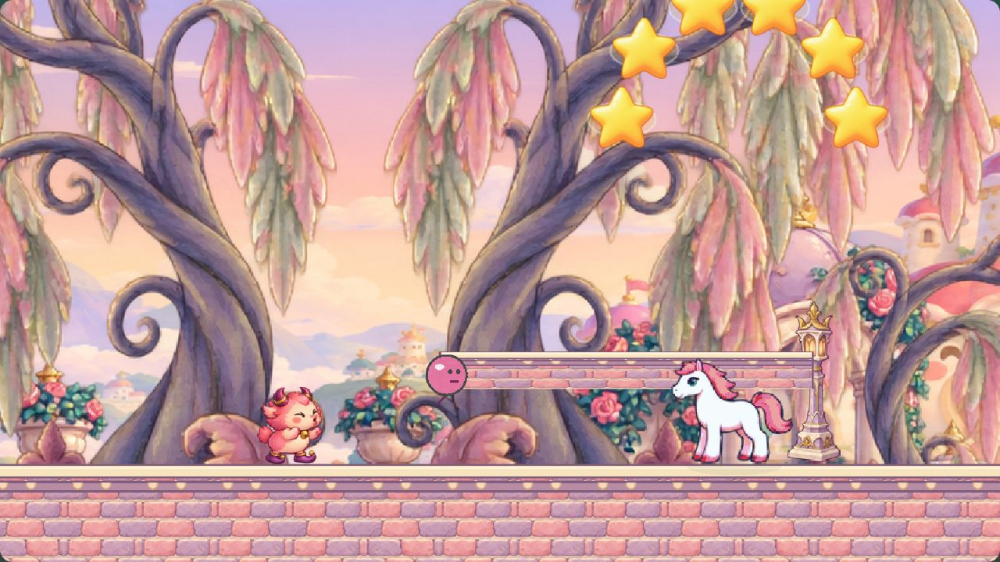
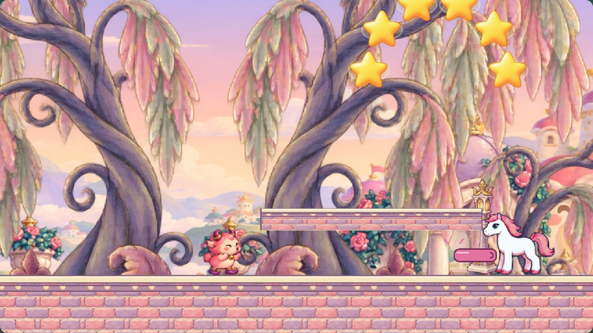

# 메롱 꼬마 풍선 공격 검수

천천히 걸어와 부딪히기만 하던 메롱 꼬마에게, 볼을 부풀려 메롱 풍선을 불고 풍선이 두 번 튄 뒤 짧은 혀를 내미는 원거리 장난을 추가했습니다.

## 동작과 대응

- 주인공이 같은 높이의 85~430px 거리에 보이면 주인공 방향으로 1.1초간 볼을 부풀립니다. 준비 후 발사 방향은 고정합니다.
- 풍선이 약 1.05초 동안 두 번 튀며 전진하고, 0.26초간 부푼 다음 0.32초간 짧은 혀를 내밉니다. 주인공을 따라 꺾이지 않습니다.
- 가까워진 풍선을 기본 점프로 넘거나 앞을 향한 날개 방어로 막을 수 있습니다. 너무 일찍 점프하면 두 번째 튀기에 착지하며 맞을 수 있습니다.
- 풍선과 터지는 혀는 한 공격으로 취급합니다. 피격·방어 중 하나가 발생하면 전체 공격을 정리해 중복 피해를 막습니다.
- 준비·공격·회복 전용 포즈 3개를 추가했습니다. 화면에 문구·미래 범위·경고선을 그리지 않습니다. 스크린 리더 설명은 유지합니다.
- 낭떠러지에서 돌아서며 연속된 바닥 안에서만 풍선과 혀를 전개합니다. 부활·화면 이탈·밟기 처치·재로드·종료 때 공격을 정리합니다.
- 쉬움에서는 준비 시간이 1.54초로 늘고 풍선이 30% 느려지며 이동 거리·혀 길이·튀는 높이가 줄어듭니다.
- 기존 접촉 피해 1과 밟기 처치 40점을 유지합니다.

## 검증

`npm test`, `npm run validate`, `npm run build`, `npm run validate:runtime` 통과. 시각 에셋 621개·오디오 106개와 새 3포즈의 투명 알파·여백·발 기준선·manifest/애니메이션 연결을 확인했습니다.

실제 Phaser 브라우저 실행에서 보통·쉬움 모두 다음을 확인했습니다.

- 좌우 준비 포즈, 방향 고정, 반대편 안전, 풍선 피해, 터지는 혀 피해, 실제 점프 회피, 실제 날개 방어, 한 발 중복 피해 방지.
- 일시정지·부활 정리, 다섯 필드 구간 완주, 두 낭떠러지 통과, 재로드 공격 표시 제거, 좌우 순찰, 접촉 피해, 밟기·패배 포즈·40점.
- 보스 세 단계 실제 점프 타격, 실패 복귀 후 깎인 HP·단계 유지, 게이트 진입과 임시 저장. 검증 중 사용자 기존 기록은 보존했습니다.
- 필드 완주: 보통 31.0초/별 65개, 쉬움 31.4초/별 65개. 두 탭 모두 콘솔 오류·경고 없음.

기록: [보통](../references/merong-imp-attack-normal.txt), [쉬움](../references/merong-imp-attack-easy.txt).

재현: `npm run dev` 후 `/scripts/merong-runtime.html?visualReview=level-07&debug=1&mute=1`에서 검증 버튼을 누릅니다. 쉬움은 `&easy=1`을 추가합니다. 검증 진입점만 타이머 기반 60 FPS를 사용해 비활성 브라우저의 프레임 제한을 피합니다.

## 실제 게임 화면

준비 동작:

발사된 풍선:

풍선이 터지며 말린 혀 전개:

미리보기는 같은 진입점에서 `debug=1`을 빼고 `&impPreview=warning`, `&impPreview=balloon`, `&impPreview=burst`를 추가합니다. 왼쪽 공격은 `&direction=left`로 확인할 수 있습니다. AI의 실제 상태와 시간을 기다린 뒤 정지한 화면입니다.

새 원화·내장 image_gen 프롬프트·조립 정보: `assets/_source/merong-imp-attack/`. 조립 명령: `node scripts/build-merong-imp-attack.js`.
