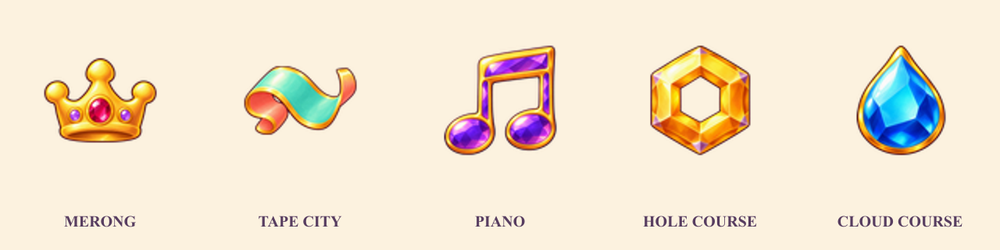
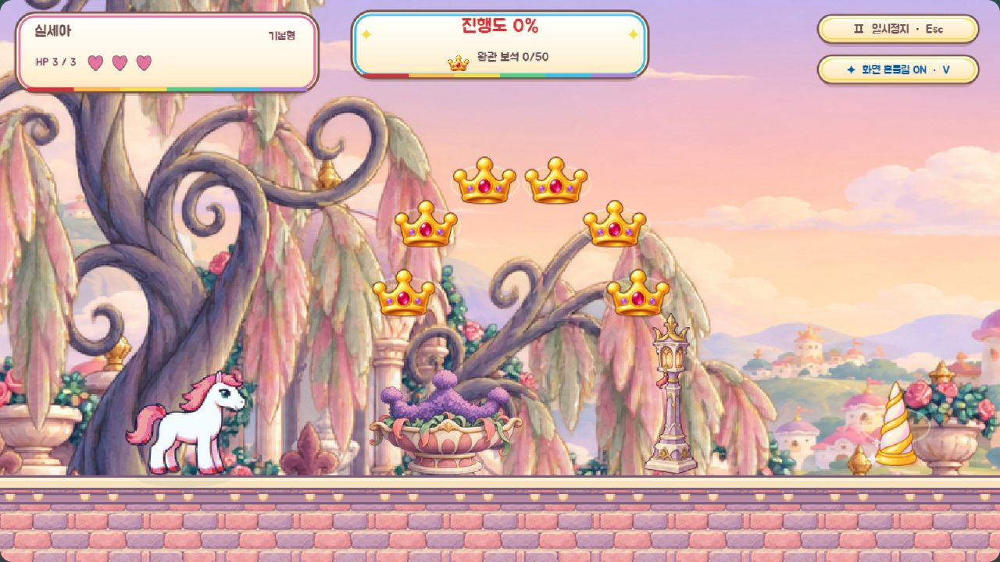
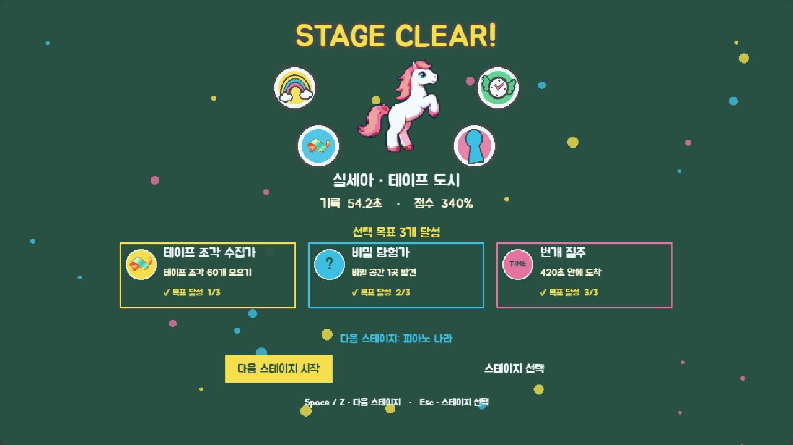

# 메롱 왕국 이후 전용 수집물

메롱 왕국부터 공용 별 대신 각 스테이지에 어울리는 수집물을 표시합니다. 금빛 테두리와 큰 하이라이트를 공통으로 쓰고 형태·주색을 달리해 구분합니다.

| 스테이지 | 수집물 | 형태 |
|---|---|---|
| 메롱 왕국 | 왕관 보석 | 세 갈래 왕관과 붉은 중앙 보석 |
| 테이프 도시 | 테이프 조각 | 청록 앞면·분홍 뒷면의 말린 테이프 |
| 피아노 나라 | 음표 보석 | 금빛 테두리의 보라색 연결 음표 |
| 구멍 코스 | 고리 보석 | 중앙이 뚫린 육각형 호박색 보석 |
| 구름 코스 | 빗방울 보석 | 금빛 테두리의 파란 물방울 보석 |

## 연결 범위

- level-07~11의 `assets.objects.items.star`만 전용 원화로 교체합니다. 앞의 다섯 코스와 공용 별 원본은 유지합니다.
- 기존 호 배치·48px 수집 판정·점수·콤보·자석·선택 목표 판정과 기록 키를 유지합니다.
- 전용 수집물을 쓰는 코스의 HUD는 아이콘·이름·실제 수집 개수/목표를 표시합니다. 변신 안내, 결과 카드, 결과 스티커, 접근성 요약도 같은 이름과 모양을 사용합니다.
- 원화 누락 시에도 왕관·테이프·음표·고리·빗방울 도형을 그립니다. 이 경로에서 발견된 기존 적의 도형 반전/애니메이션 메서드 누락도 안전하게 처리하고 회귀 검사를 추가했습니다.
- 내장 image_gen 원본·프롬프트: `assets/_source/stage-collectibles/`. 재조립: `node scripts/build-stage-collectibles.js`.

## 검증

`npm test`, `npm run validate`, `npm run build`, `npm run validate:runtime` 통과. 원화의 RGBA·투명 여백·비율·고리 중앙 구멍, manifest와 매핑, 앞 스테이지의 공용 별 유지, 양 난이도의 배치·목표·결과 호환을 검사했습니다.

실제 Phaser 브라우저에서 5개 스테이지 × 보통/쉬움 × 원화/도형 모드 20개 조합을 확인했습니다. 각 조합에서 전용 수집물·HUD, 실제 접촉 수집과 점수/콤보, 자석 이동/수집, 목표 달성, 결과 카드와 스티커를 검사했습니다. 목표 완료 경계는 수집 개수를 목표 직전으로 설정한 뒤 실제 아이템을 수집해 확인합니다. 사용자 진행 기록이 변경되지 않았고 최종 두 검증 탭의 콘솔 오류·경고가 없습니다.

- [원화 모드 기록](../references/stage-collectibles-runtime-normal.txt)
- [도형 모드 기록](../references/stage-collectibles-runtime-fallback.txt)

재현: `npm run dev` 후 `/scripts/stage-collectibles-runtime.html?visualReview=level-07&mute=1`의 검증 버튼을 누릅니다. `&fallback=1`은 원화 누락 모드입니다. 검증 페이지에만 타이머 기반 60 FPS를 사용해 비활성 탭의 프레임 제한을 피합니다.

게임 화면: 같은 페이지에서 `visualReview=level-07`~`level-11`과 `&collectiblePreview=field`를 사용합니다. `&collectiblePreview=result`는 선택 목표 결과와 스티커를 확인합니다. 실제 로드된 원화와 게임 장면을 정지해 촬영합니다.

