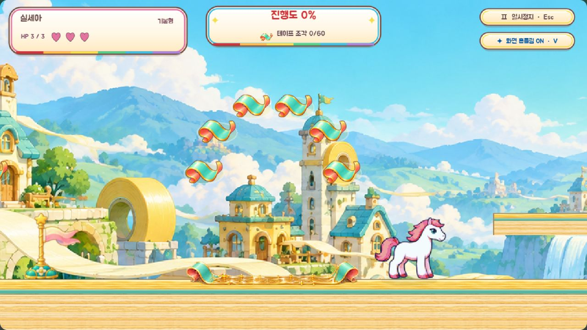

# 테이프 도시 접착제 원화

테이프 바닥 위의 ‘끈끈한 테이프 / 점프로 빠져나가요’ 안내판과 노란 사선 도형을 제거했습니다. 대신 민트색 종이의 말린 끝, 산호빛 뒷면, 호박빛 접착제와 기포·반사를 그린 투명 원화를 적용했습니다. 바닥과 보스가 설치하는 테이프가 같은 재질을 사용합니다.

양끝은 고정 크기로 두고 중앙 접착제만 길이에 맞춰 늘립니다. 기존 구간의 가로 길이에 정확히 맞으며, 물리 몸체를 추가하지 않습니다. 보통 0.6배·쉬움 0.8배 감속과 점프·비행 탈출 규칙을 보존했습니다. 보스 설치물의 원화는 만료·부활·약점 노출·처치·장면 종료 시 함께 정리합니다.

## 원본 및 재생성

내장 `image_gen`을 사용했습니다. [투명 생성 원본](../assets/_source/sticky-tape/original.png), [실제 생성 프롬프트](../assets/_source/sticky-tape/prompt.txt), [원화 안내](../assets/_source/sticky-tape/README.md).

`node scripts/build-sticky-tape.js`로 384×40 RGBA PNG 및 3프레임 아틀라스를 만듭니다. 결과: `assets/effects/fx_sticky_tape.png`, `fx_sticky_tape.json`.

## 확인된 검사

- `npm test`, `npm run validate`, `npm run build`, `npm run validate:runtime` 통과.
- 3분할 아틀라스의 연속된 영역·전체 폭·RGBA 크기, PNG의 실제 알파·모서리 여백·불투명 픽셀 검사 통과.
- 일반 모드 실제 플레이: 안내 문구 제거, 모든 구간의 원화와 판정 폭 일치, 이동 발판, 0.6배 감속, 점프·비행 탈출, 두 적과 보스 세 단계, 부활 후 깎인 HP 보존, 설치물 원화 정리, 게이트와 기존 진행 기록 보존 통과. 필드 37.8초, 수집물 94개. 콘솔 오류·경고 없음.
- 쉬운 모드 실제 플레이: 0.8배 감속과 동일한 탈출·보스·원화 정리·게이트·기록 보존 검사 통과. 필드 36.6초, 수집물 91개. 콘솔 오류·경고 없음.
- [일반 모드 실행 기록](../references/sticky-tape-runtime-normal.txt), [쉬운 모드 실행 기록](../references/sticky-tape-runtime-easy.txt).

재현: 개발 서버의 `/scripts/tape-runtime.html?visualReview=level-08&debug=1&mute=1` 검증 버튼. 쉬움은 `&easy=1`을 추가합니다. 촬영 화면은 `debug=1` 없이 `&tapePreview=sticky`를 추가합니다.
